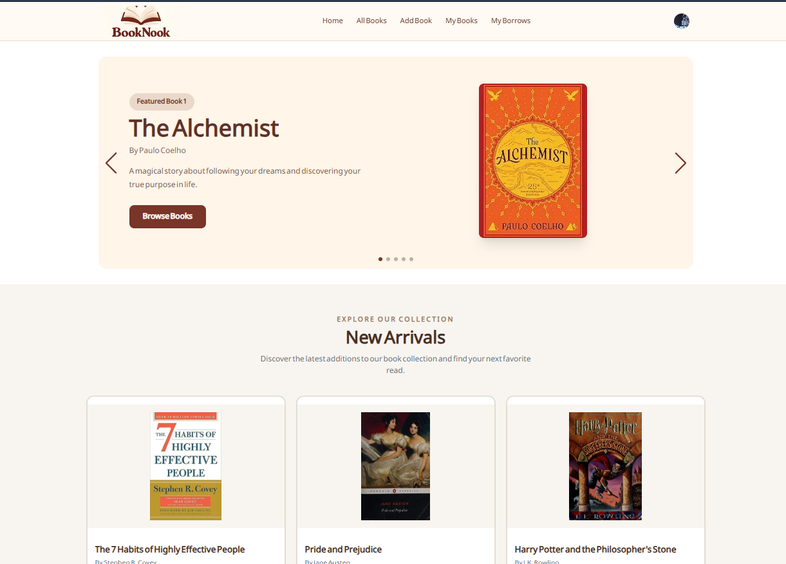

# 📚 BookNook — Your Little Online Library

<p align="center">
  
  
  
  
</p>

<p align="center">
  <b>Discover. Borrow. Read. Return.</b>
  <br />
  A cozy little corner for every book lover! ☕
  <br /><br />
  <a href="https://booknook-virid.vercel.app/">
    
  </a>
</p>

---

## ✨ About BookNook

Welcome to **BookNook**, a small online library designed to make your reading journey easier and more enjoyable!

Discover your next favorite book, share books with the community, manage your personal collection, and keep track of your borrowed reads — all in one place.

From adding a new book to returning a borrowed one, BookNook brings a simple and interactive library experience to your fingertips.

<p align="center">
  <i>📖 Because every great adventure begins with a book!</i>
</p>

---

## 🌟 Features

<table>
  <tr>
    <td width="50%" align="center">
      <h3>📚 Explore Books</h3>
      <p>Browse the library and discover books from different categories.</p>
    </td>
    <td width="50%" align="center">
      <h3>🔍 Book Details</h3>
      <p>Explore detailed information about individual books.</p>
    </td>
  </tr>
  <tr>
    <td width="50%" align="center">
      <h3>➕ Add New Books</h3>
      <p>Authenticated users can contribute new books to the library.</p>
    </td>
    <td width="50%" align="center">
      <h3>📖 Manage My Books</h3>
      <p>Edit, delete, and manage your own book collection.</p>
    </td>
  </tr>
  <tr>
    <td width="50%" align="center">
      <h3>🤝 Borrow Books</h3>
      <p>Borrow available books with specific borrowing and return dates.</p>
    </td>
    <td width="50%" align="center">
      <h3>📋 Track My Borrows</h3>
      <p>Keep track of borrowed books and their current statuses.</p>
    </td>
  </tr>
  <tr>
    <td width="50%" align="center">
      <h3>🔄 Return Books</h3>
      <p>Return borrowed books and update their availability.</p>
    </td>
    <td width="50%" align="center">
      <h3>🔐 Secure Authentication</h3>
      <p>Sign up and log in with Better Auth.</p>
    </td>
  </tr>
</table>

<p align="center">
  📱 Fully Responsive &nbsp; • &nbsp; 🔔 Interactive UI &nbsp; • &nbsp; ⚡ Smooth Navigation
</p>

---

## 🛠️ Tech Stack

<p align="center">
  
</p>

| Technology | Purpose |
|:---:|---|
| **Next.js** | React framework and application routing |
| **TypeScript** | Type safety and maintainable code |
| **Tailwind CSS** | Responsive styling |
| **shadcn/ui** | Reusable UI components |
| **Better Auth** | Authentication and session management |
| **Lucide React** | Icons and visual elements |
| **MongoDB** | Database |
| **Express.js** | Backend API |

---

## 🖥️ Project Preview

<p align="center">
  
</p>

<p align="center">
  <i>More screenshots coming soon...</i>
</p>

---

## 🚀 Getting Started

Want to explore BookNook on your local machine? Follow these steps.

### 1. Clone the Repository

```bash
git clone https://github.com/Wazida-in-code/BookNook-Client.git
cd BookNook-Client
```

### 2. Install Dependencies

```bash
npm install
```

### 3. Configure Environment Variables

Create a `.env.local` file in the root directory:

```env
NEXT_PUBLIC_BASE_SERVER_URL=your_backend_url
BETTER_AUTH_SECRET=your_secret_key
BETTER_AUTH_URL=your_auth_url
```

Add any additional environment variables required by your project.

### 4. Start the Development Server

```bash
npm run dev
```

Open [http://localhost:3000](http://localhost:3000) in your browser.

And you're ready to explore BookNook! 🎉

---

## 📂 Project Highlights

- Organized Next.js App Router structure.
- Reusable components for a consistent user interface.
- Protected routes for authenticated users.
- Integrated frontend and backend functionality.
- Dynamic book and borrowing management.
- Authentication and session handling.

---

## 💌 A Little Note

BookNook is more than just a small library project — it's a step in my journey of learning and building meaningful web applications.

Built with curiosity, creativity, and lots of coffee. ☕

<p align="center">
  <b>📚 BookNook — Where Every Book Finds a Reader.</b>
  <br /><br />
  Made with ❤️
</p>